# 《그건 님이!!!》 웹 빌드 비픽셀 리소스 점검

**점검일** 2026-11-19 KST · **기준** 프로토타입 0.7, `MJ` 브랜치의 `73101bc`와 현재 작업 트리의 변경분 · **환경** 로컬 Vinext/Vite 웹 미리보기, Windows Chrome, 1440 × 900

비픽셀 요소가 화면에서 가장 넓게 보이는 곳은 **숲과 도로**, **지하층 실내**, **웹 조작 UI**다. 도로 장애물과 투석기 바위도 Canvas 도형으로 그려진다. 갑판과 캐릭터의 픽셀 스프라이트 주변에는 그림자, 조준 표시, 작업 라벨 같은 비픽셀 레이어가 함께 표시된다.

## 리소스 목록

이 표의 한 행은 교체 범위를 파악할 수 있도록 묶은 리소스 그룹이다. Canvas에서 직접 그리는 곡선·도형·그라데이션, SVG, 브라우저 스타일·글꼴·이모지를 포함했다. 픽셀 PNG를 Canvas에 출력하는 경로와 해당 이미지의 로딩 실패 시에만 쓰는 대체 그림은 집계에서 제외했다.

| ID | 화면 | 비픽셀 리소스 | 구현 위치 | 화면 근거 |
| --- | --- | --- | --- | --- |
| 01 | 숲·도로 배경 | 침엽수, 관목, 풀, 장식 돌, 울타리, 길가의 충돌 나무, 도로 면·경계 곡선·바퀴 자국·점무늬. 침엽수는 Canvas 도형을 오프스크린 캔버스에 캐시한다. | [`scene.mjs` 숲과 도로](../../../goblin-getaway/public/scene.mjs#L20), [충돌 나무](../../../goblin-getaway/public/scene.mjs#L250) | [01 출발 대기](screenshots/01-ready.png), [08 주행](screenshots/08-road-and-route.png) |
| 02 | 도로 장애물 | 도로 위 바위, 쓰러진 통나무, 사슴과 각 장애물의 타원형 그림자. | [`scene.mjs` 장애물 3종](../../../goblin-getaway/public/scene.mjs#L198) | [08 바위](screenshots/08-road-and-route.png), [10 통나무](screenshots/10-road-log.png), [11 사슴](screenshots/11-road-deer.png) |
| 03 | 마차 지하층 실내 | 검은 외곽, 실내 바닥 판재와 이음새, 난간·볼트·차축 고정부, 두 등불의 형태와 방사형 빛 번짐. | [`scene.mjs` 등불과 지하층](../../../goblin-getaway/public/scene.mjs#L919) | [12 지하층 전경](screenshots/12-cellar.png) |
| 04 | 적재·보급·조리·수리 소품 | 갑판 포탄 적재 트레이와 포탄 위의 타원 하이라이트, 지하 보급 수량 배지, 조리대·접시·음식·팬, 예비 바퀴 보관 상자, 바퀴 수리 지점 외곽선과 라벨. | [`scene.mjs` 적재와 작업대](../../../goblin-getaway/public/scene.mjs#L420), [수리 표시](../../../goblin-getaway/public/scene.mjs#L673) | [01 갑판](screenshots/01-ready.png), [12 지하층](screenshots/12-cellar.png), [13 보급 작업](screenshots/13-cellar-timing.png), [14 조리대](screenshots/14-cellar-cook.png) |
| 05 | 갑판·캐릭터 오버레이 | 작업 칸 이름표와 상태 점선, 계단 화살표·라벨, P1~P4 라벨·이동 방향 삼각형, 운반 중인 포탄·음식·팔, 떨어지는 포탄, 왕실 인계·먹이기 표시. | [`scene.mjs` 왕실 표시](../../../goblin-getaway/public/scene.mjs#L314), [작업 칸·캐릭터·계단](../../../goblin-getaway/public/scene.mjs#L432), [낙하 포탄](../../../goblin-getaway/public/scene.mjs#L930) | [01 갑판](screenshots/01-ready.png), [12 지하층 전경](screenshots/12-cellar.png), [18 왕실 근접](screenshots/18-royal-watch.png) |
| 06 | 마차·말·기병 효과 | 차체 밑 그림자와 주행 먼지, 바퀴 이탈 시 그림자·먼지와 비어 있는 고정부, 말발굽·기병 그림자 및 질주 먼지, 마부의 점선 조준선·원형 조준점·채찍 궤적과 불꽃, 말의 상처 표시·이탈 속도선·상태 라벨. | [`scene.mjs` 바퀴](../../../goblin-getaway/public/scene.mjs#L615), [말과 마부](../../../goblin-getaway/public/scene.mjs#L714), [차체 그림자](../../../goblin-getaway/public/scene.mjs#L896), [기병](../../../goblin-getaway/public/scene.mjs#L1045), [주행 먼지](../../../goblin-getaway/public/scene.mjs#L1531) | [08 주행](screenshots/08-road-and-route.png), [09 바퀴 이탈](screenshots/09-catapult-impact.png), [15 마부 조준](screenshots/15-driver-aim.png) |
| 07 | 대포 조준·착탄 | 포구에서 이어지는 점선, 조준 범위 타원, 시야 밖 방향 화살표, 포구 연무, 그을음·그라데이션 충격파·먼지·연기와 공용 파편. 조준점·점화 카운트·날아가는 포탄의 PNG 레이어는 픽셀 리소스다. | [`scene.mjs` 포구 연무](../../../goblin-getaway/public/scene.mjs#L1131), [충격파와 조준](../../../goblin-getaway/public/scene.mjs#L1189) | [16 대포 조준](screenshots/16-cannon-aim.png), [17 대포 착탄](screenshots/17-cannon-blast.png), [25 대포 발사](screenshots/25-cannon-burst.png) |
| 08 | 투석기 | 착탄 예고 타원과 위험 테두리, 낙하·착탄 바위, 충격 고리와 연기·돌조각. 마차 충돌 위험 위치의 느낌표는 Lucide SVG다. | [`scene.mjs` 투석기](../../../goblin-getaway/public/scene.mjs#L1323), [`page.tsx` 경고 SVG](../../../goblin-getaway/app/page.tsx#L118) | [09 착탄](screenshots/09-catapult-impact.png), [22 착탄 경고](screenshots/22-catapult-warning.png) |
| 09 | 주행 HUD·조작 버튼 | 시작·정지·테스트·설정, 이동·조준 스틱, 행동·이탈·이모티콘 버튼과 아이콘. 작전 진행 막대와 상단의 마차·깃발은 HTML/CSS와 인라인 SVG로 표시한다. | [`page.tsx` 조작부](../../../goblin-getaway/app/page.tsx#L37), [작전 HUD](../../../goblin-getaway/app/page.tsx#L91), [`game.mjs` 시작·정지 아이콘](../../../goblin-getaway/public/game.mjs#L872) | [01 출발 대기](screenshots/01-ready.png), [08 작전 진행](screenshots/08-road-and-route.png) |
| 10 | 상태·작업 HUD | 타이밍 링과 바늘, 작업 안내 말풍선, 진행률 막대, 가까운 왕자·공주 상태 카드, 분할 화면 P1/P2 표식. 도로 장애물·후방 추격의 화면 가장자리 경고는 Canvas 삼각형이다. | [`page.tsx` 작업·타이밍 HUD](../../../goblin-getaway/app/page.tsx#L4), [`game.mjs` 상태 표시](../../../goblin-getaway/public/game.mjs#L743), [`globals.css` 분할 화면](../../../goblin-getaway/app/globals.css#L246), [`scene.mjs` 가장자리 경고](../../../goblin-getaway/public/scene.mjs#L1435) | [13 타이밍 링](screenshots/13-cellar-timing.png), [18 왕실 상태](screenshots/18-royal-watch.png), [24 장애물 접근 경고](screenshots/24-approach-alert.png), [26 2인 분할](screenshots/26-local-split.png) |
| 11 | 이모티콘 | `💣 🔄 🛠️ 🐎 🍼 👍 😮` 7종. 선택창·상단 알림은 브라우저 글꼴, 캐릭터 위 말풍선은 Canvas 원과 시스템 이모지 글꼴을 사용한다. | [`emotes.mjs` 이모지 목록](../../../goblin-getaway/public/emotes.mjs#L1), [`game.mjs` 선택창](../../../goblin-getaway/public/game.mjs#L129), [`scene.mjs` 캐릭터 말풍선](../../../goblin-getaway/public/scene.mjs#L1417) | [06 선택창](screenshots/06-emote-menu.png), [07 상단 알림과 말풍선](screenshots/07-emote-bubble.png) |
| 12 | 설정·협동·도움말·결과 | 환경설정·작전 현황의 Lucide 아이콘과 CSS 패널. 협동 방번호 입력·탑승원 배지, 조작 가이드, 정비 카드 도감, 패배·마왕 보고·팀 정비 상점의 HTML/CSS 카드와 상태 배지. 도감과 상점에서 글자 기호 `+ ◎ ≈ ◉ ◇ ➜ ⌁ »`를 사용한다. | [`page.tsx` 설정·현황](../../../goblin-getaway/app/page.tsx#L58), [`game.mjs` 메뉴·결과](../../../goblin-getaway/public/game.mjs#L257), [`intermission.mjs` 카드 기호](../../../goblin-getaway/public/intermission.mjs#L4) | [02 설정](screenshots/02-settings.png), [03 협동](screenshots/03-coop.png), [04 가이드](screenshots/04-guide.png), [05 도감](screenshots/05-card-index.png), [19 패배](screenshots/19-defeat.png), [20 마왕 보고](screenshots/20-report-to-king.png), [21 상점](screenshots/21-upgrade-shop.png), [23 작전 현황](screenshots/23-status.png) |
| 13 | 화면 전반 글꼴 | 웹 UI의 Inter·Pretendard·Noto Sans KR·맑은 고딕 등의 폴백 체인, Canvas 이름표의 `system-ui` 및 `monospace`. | [`globals.css` 글꼴](../../../goblin-getaway/app/globals.css#L2), [`scene.mjs` Canvas 라벨](../../../goblin-getaway/public/scene.mjs#L493) | [02 환경설정](screenshots/02-settings.png), [12 지하층 라벨](screenshots/12-cellar.png) |
| 14 | 브라우저 탭 | SVG 파비콘. 페이지 바깥의 탭 영역이라 아래 캡처는 페이지 콘텐츠만 보여준다. | [`layout.tsx` 메타데이터](../../../goblin-getaway/app/layout.tsx#L4), [파비콘 원본](../../../goblin-getaway/public/favicon.svg) | SVG 원본으로 확인 |

## 스크린샷

### 출발 대기 · 숲과 도로, 갑판 라벨, 조작 UI

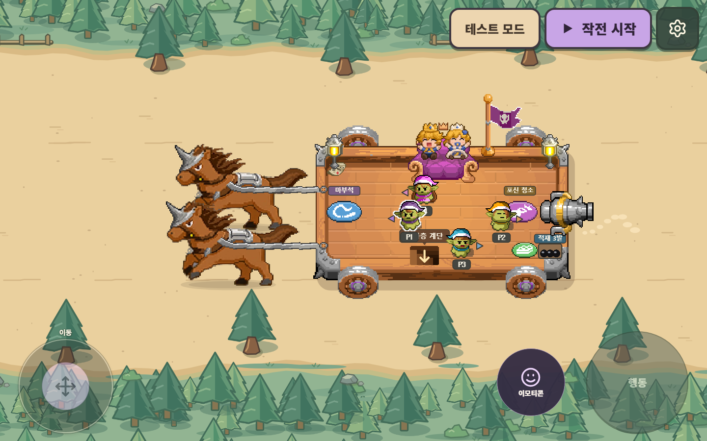

### 주행 · 도로 장애물, 작전 진행 HUD

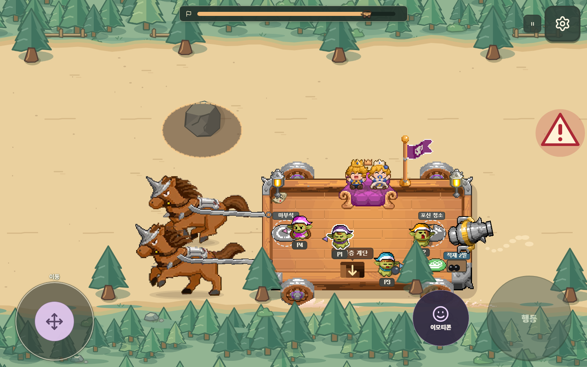

[통나무](screenshots/10-road-log.png) · [사슴](screenshots/11-road-deer.png) · [도로 장애물 접근 경고](screenshots/24-approach-alert.png)

### 지하층 · 판재, 등불, 작업대

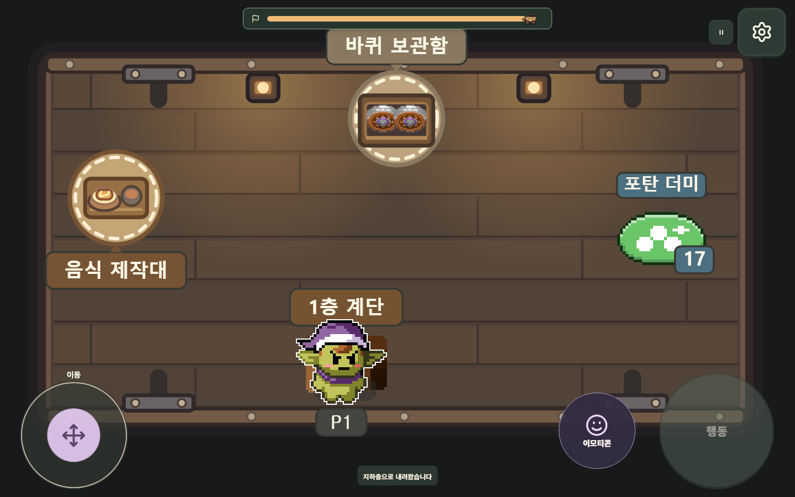

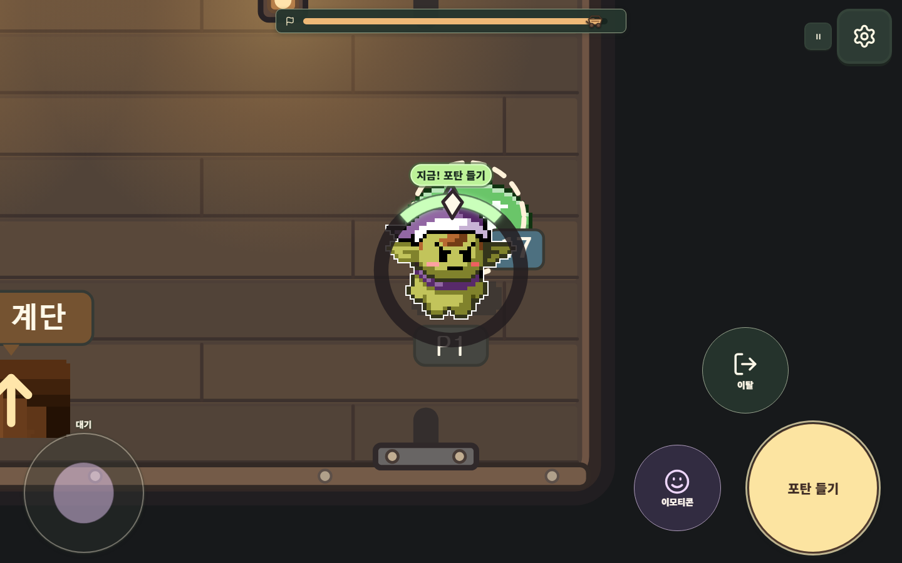

[조리대 확대](screenshots/14-cellar-cook.png) · [왕실 상태 카드](screenshots/18-royal-watch.png) · [한 화면 2인 협동](screenshots/26-local-split.png)

### 마부와 대포 · 조준선, 동작과 착탄 효과

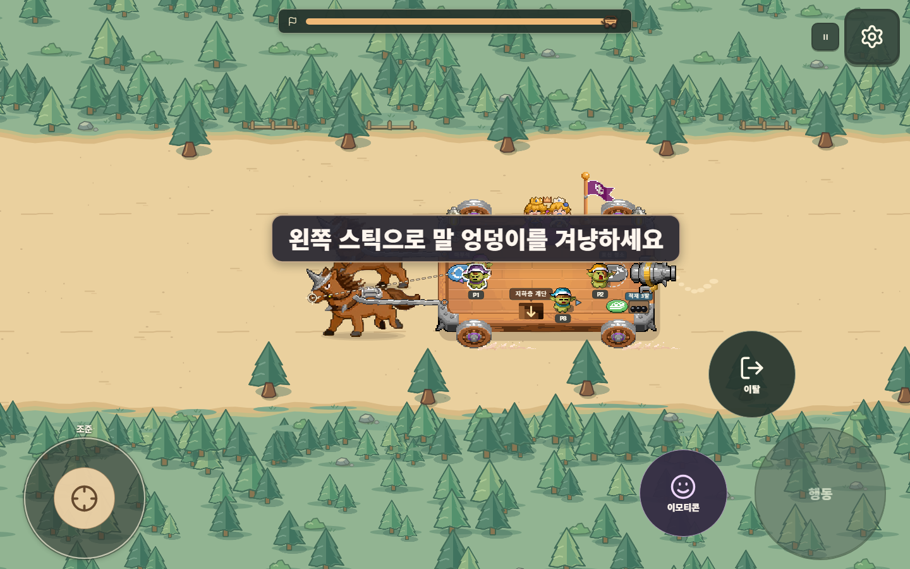

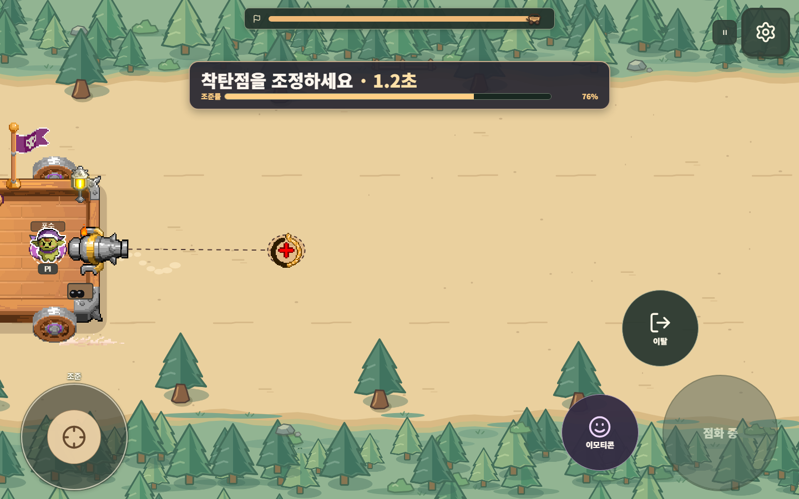

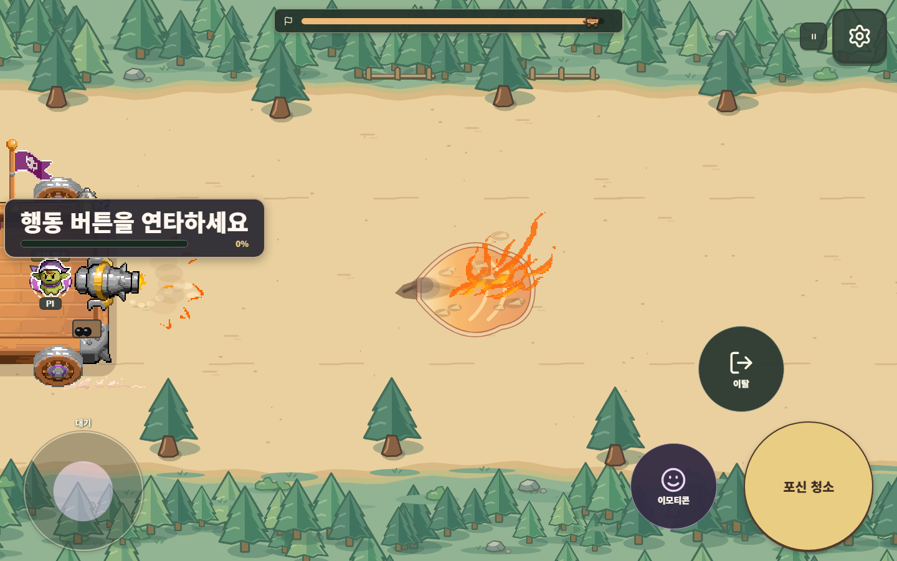

[포구의 발사 섬광과 연무](screenshots/25-cannon-burst.png)

### 투석기 · 경고와 바위 착탄

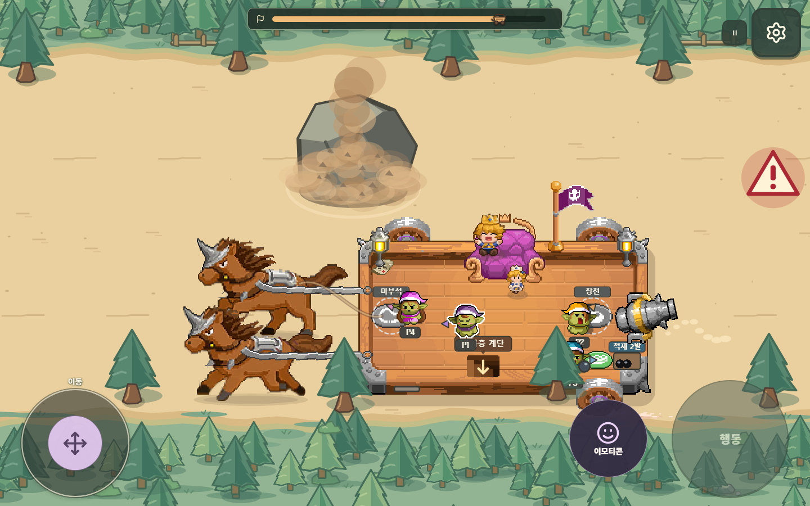

[착탄 위치의 위험 표시](screenshots/22-catapult-warning.png)

### 이모티콘 · 환경설정과 정비 상점

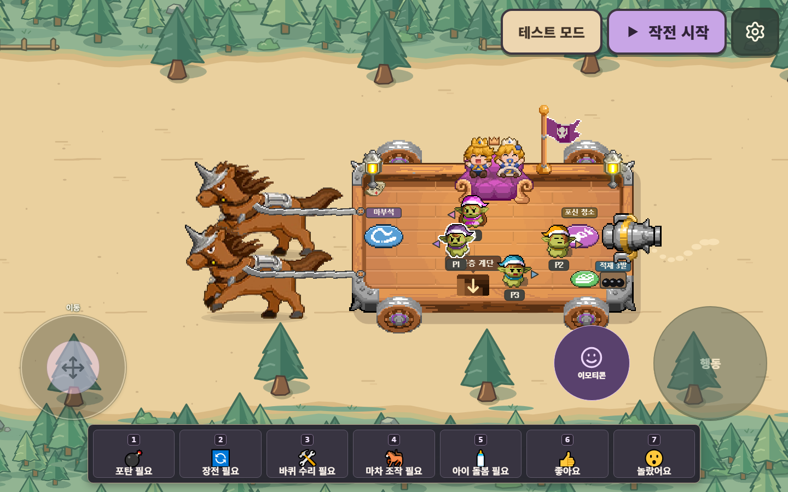

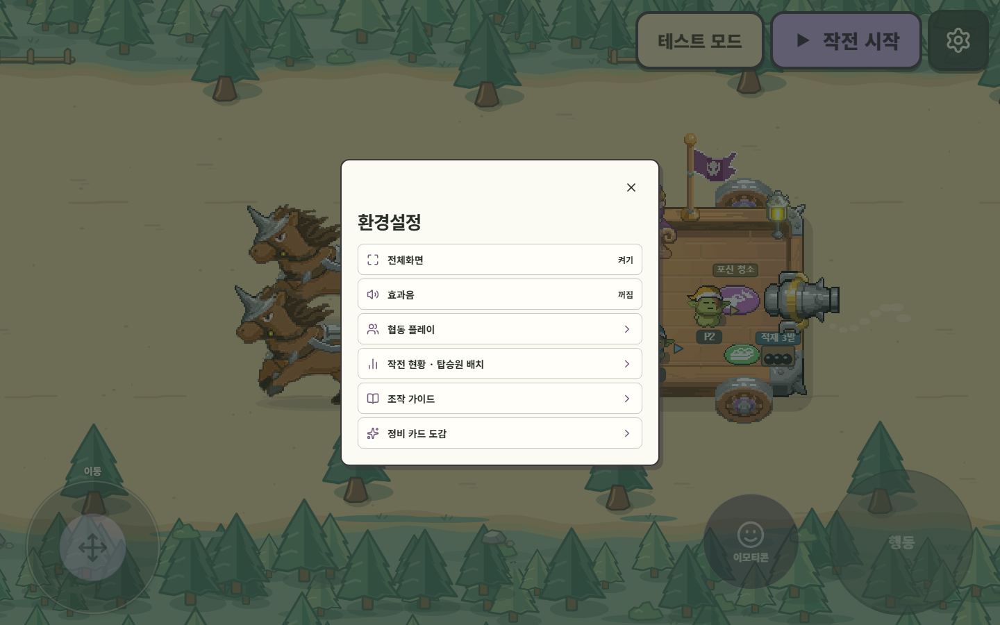

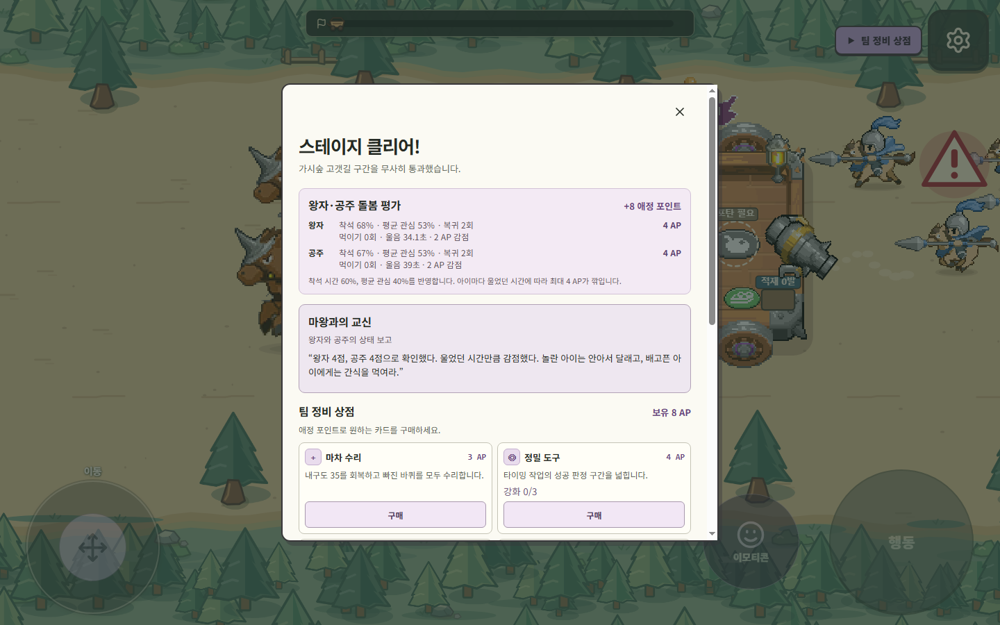

[협동 플레이](screenshots/03-coop.png) · [조작 가이드](screenshots/04-guide.png) · [정비 카드 도감](screenshots/05-card-index.png) · [이모티콘 말풍선](screenshots/07-emote-bubble.png) · [패배 결과](screenshots/19-defeat.png) · [마왕 보고](screenshots/20-report-to-king.png) · [작전 현황](screenshots/23-status.png)

## 촬영 기준

- 대기 화면과 메뉴는 브라우저에서 직접 열었다. 주행 장면은 1인 기본 시드 `718`의 시뮬레이션 상태를 촬영용 브라우저에서 원하는 시점까지 진행하고, 실제 웹 게임 코드로 렌더링해 채집했다. 대포와 조리대의 확대 장면은 해당 작업 위치를 지정해 재현했다.
- 대기·메뉴와 일부 작업 화면은 Chrome의 동작 줄이기 설정에서 촬영했다. 채찍 휘두르기, 말 이탈, 낙하 포탄은 활성 렌더링 경로를 소스에서 확인했다.
- 협동 메뉴와 로컬 2인 분할은 브라우저에서 확인했다. 브라우저 탭 파비콘과 온라인 방 생성 후 전용 화면은 소스 기준으로 확인했다.
